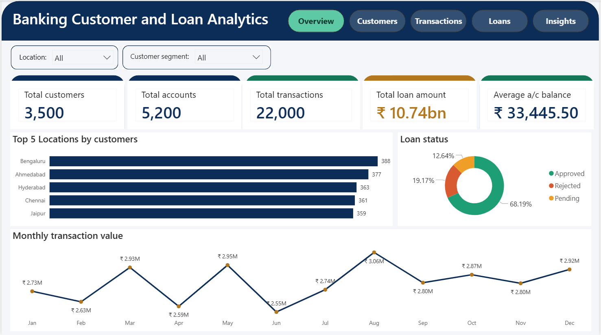
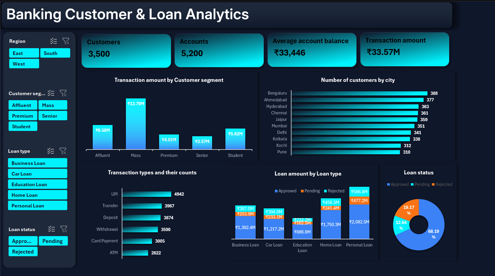
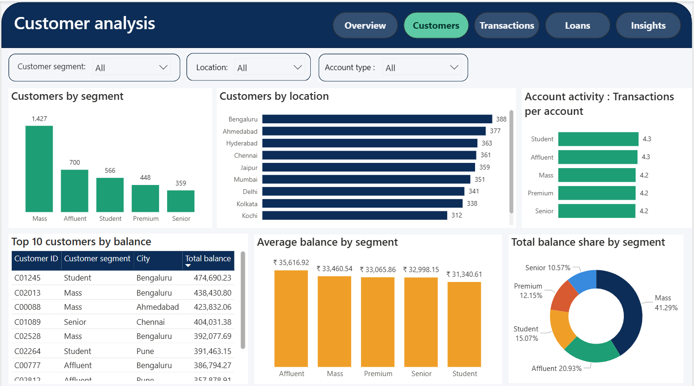
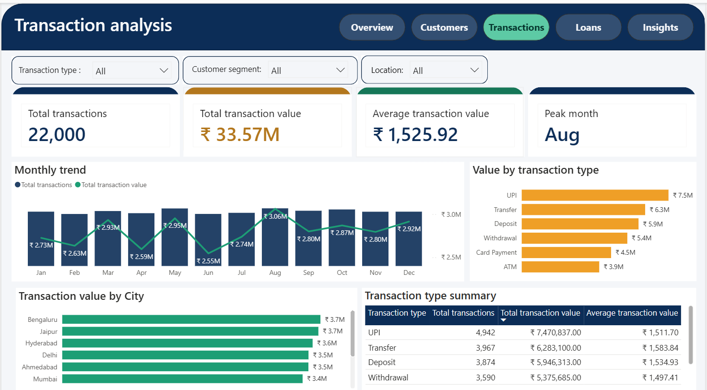
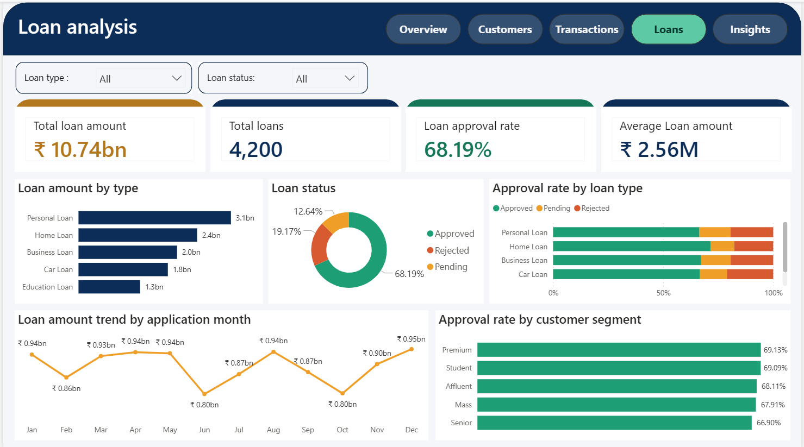
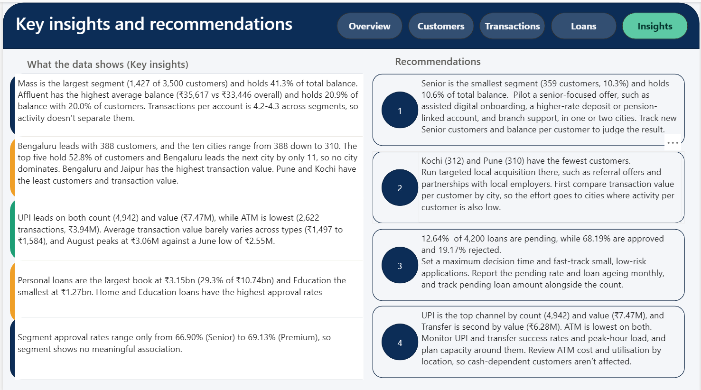

# Banking-customer-and-Loan-analytics
End-to-end banking analytics: cleaned five tables in Excel Power Query, analysed them with PivotTables and a Data Model, and built a 5-page Power BI report with 20 DAX measures on customers, transactions and loans.
<div align="center">

# 🏦 Banking Customer & Loan Analytics

### An end-to-end analytics project: Excel (Power Query, PivotTables, Data Model) → Power BI (DAX, 5-page report)




</div>

---

## 📌 Table of contents

1. [Project overview](#-project-overview)
2. [Dataset](#-dataset)
3. [Tools used](#-tools-used)
4. [Data cleaning and preparation in Excel](#-data-cleaning-and-preparation-in-excel)
5. [Excel analysis and dashboard](#-excel-analysis-and-dashboard)
6. [Power BI report pages](#-power-bi-report-pages)
7. [Key DAX measures](#-key-dax-measures)
8. [Key insights](#-key-insights)
9. [Recommendations](#-recommendations)
10. [How to use this report](#-how-to-use-this-report)
11. [Repository structure](#-repository-structure)
12. [Author](#-author)

---

## 🎯 Project overview

This project was the capstone of my **AI-Driven Data Analytics internship at NeST Digital Academy (NeST Group)**, completed in a team of four.

**The goal:** take five related banking tables, clean and connect them, and answer practical business questions about the bank's **customers, accounts, transactions and loans**.

**What was built:**

- Cleaned and prepared all five tables with **Excel Power Query**
- Built an **Excel Data Model** linking the tables, with **PivotTable** analysis and a dashboard
- Designed a **5-page Power BI report** with **20 DAX measures**, including date intelligence
- Summarised the findings and recommendations in a final presentation for the internship reviewers

### Headline numbers

| Customers | Accounts | Transactions | Loans | Total loan amount | Loan approval rate |
|:---:|:---:|:---:|:---:|:---:|:---:|
| **3,500** | **5,200** | **22,000** | **4,200** | **₹10.74 bn** | **68.19%** |

---

## 📂 Dataset

The data comes from five related tables supplied as part of the internship case study:

| Table | What it holds |
|---|---|
| `customers` | Customer details and customer segment |
| `accounts` | Accounts, balances and account status |
| `transactions` | Individual transactions: type, amount and date |
| `loans` | Loan type, amount and approval status |
| `locations` | City and location details linked to customers |

This repository includes the **cleaned Excel workbook** and the **Power BI report file (.pbix)**. Screenshots of every report page are in the `images/` folder.

---

## 🔧 Tools used

### Microsoft Excel

| Feature | How I used it |
|---|---|
| **Power Query** | Cleaned and standardised all five tables before analysis |
| **Data Model** | Connected the tables with relationships so one PivotTable could use fields from several tables |
| **PivotTables** | Answered the project's business questions on one analysis sheet |
| **Dashboard sheet** | A separate dashboard with slicers, KPI cards, charts and a key-findings strip |

### Power BI Desktop

| Feature | How I used it |
|---|---|
| **Data model** | Imported the cleaned tables and defined relationships |
| **`_Measures` table** | A dedicated table that holds all the DAX measures |
| **Date table** | A separate Date table, marked as the date table, for time intelligence |
| **DAX** | 20 measures: KPIs, rates, averages and date intelligence |
| **Report design** | 5 pages, a light theme (navy header, light grey canvas, navy / teal / amber / coral palette), slicers and page-navigation buttons |

---

## 🧹 Data cleaning and preparation in Excel

All five tables were cleaned in **Power Query** before being loaded into the Data Model.

| Table | Issue found | Fix applied |
|---|---|---|
| `customers` | Outlier value in the age column | Replaced with the median age |
| `customers` | Inconsistent segment label ("Premium" also written as "premium") | Standardised to "Premium" |
| `customers` | Null values in monthly income | Imputed with the average income of the same occupation |
| `accounts` | Open date not in date format | Converted to date format |
| `accounts` | Nulls and outliers | None found in any column |
| `transactions` | Transaction date not in date type | Converted to date type |
| `transactions` | 35 null values in transaction amount | Replaced with the mean transaction amount |
| `transactions` | Two variants of "Success" in transaction status | Merged into one label |
| `loans` | 25 null values in interest rate | Replaced with the mean interest rate of the same loan type |
| `loans` | Inconsistent loan status labels ("Approved" and "approved") | Standardised to "Approved" |
| `loans` | Application date not in date format | Fixed the date format |
| `locations` | First row not set as the header | Promoted the first row to headers |
| All five tables | Duplicate records | Removed |

**Preparation steps**

1. Loaded each table into Power Query
2. Cleaned and standardised the columns (see the table above)
3. Loaded the cleaned tables into the Excel Data Model
4. Created relationships between the tables
5. Built PivotTables on top of the model

---

## 📊 Excel analysis and dashboard

The Excel workbook has two main sheets:

- **Analysis sheet:** PivotTables answering the project's business questions
- **Dashboard sheet:** slicers across the top, five KPI cards, charts in two rows and a key-findings strip at the bottom, in a green palette



---

## 📑 Power BI report pages

The report has five pages. Use the buttons in the header to move between them.

### 1. Overview
The summary page. Two slicers (**Location** and **Customer segment**), five KPI cards (total customers, accounts, transactions, total loan amount and average account balance), the top 5 locations by customers, loan status split and monthly transaction value.


### 2. Customers
Who the customers are: segment mix and how customers are spread across locations.



### 3. Transactions
How customers transact: transaction types, transaction value and the trend over time.



### 4. Loans
The loan portfolio: loan amount by type, approval and rejection rates, and loan status.



### 5. Insights
The key findings and recommendations drawn from the other four pages.



---

## 🧮 Key DAX measures

```DAX
Total customers = DISTINCTCOUNT(Customers[Customer_ID])

Total accounts = DISTINCTCOUNT(Accounts[Account_ID])

Total transactions = COUNTROWS(Transactions)

Total transaction value = SUM(Transactions[Transaction_Amount])

Total Loan amount = SUM(Loans[Loan_Amount])

Average transaction value = AVERAGE(Transactions[Transaction_Amount])

Loan Approval rate =
    DIVIDE(
CALCULATE(COUNTROWS(Loans),Loans[Loan_Status]="Approved"),CALCULATE(COUNTROWS(Loans),REMOVEFILTERS(Loans[Loan_Status]))
)
```

| Measure | What it answers |
|---|---|
| Total Customers / Accounts / Transactions | The size of the customer base and activity |
| Total Transaction Value | How much money moved through transactions |
| Total Loan Amount | The size of the loan portfolio |
| Average Transaction Value | Typical size of a single transaction |
| Loan Approval Rate | Share of loan applications that were approved |

---

## 💡 Key insights

- **No single city dominates the customer base.** The top 5 locations are Bengaluru (388), Ahmedabad (377), Hyderabad (363), Chennai (361) and Jaipur (359). The four largest cities together hold 42.5% of customers.
- **Customer segments look alike.** They have a similar share of balance, about 4.2 to 4.3 transactions per account, and loan approval between 66.9% and 69.1%. Senior is the smallest segment (359 customers, 10.3%) with 10.6% of balance.
- **Customer segment showed no direct link to loan approval.**
- **UPI and Transfer together make up about 41% of transactions and value**, while ATM and Withdrawal make up about 28%. UPI is the most-used transaction type.
- **Monthly transaction value peaked in August (₹3.06M) and was lowest in June (₹2.55M, about 9% below the monthly average).** The data covers a single year, so this is a pattern to investigate, not a confirmed seasonal trend.
- **Personal loans are the largest loan category by total amount.**
- **68.19% of loans were approved**, with about 805 (19.17%) rejected and about 531 (12.64%) pending.
- **Value per customer averages ₹9,591.** Pune (₹8,807) and Chennai (₹8,892) are below it, and Kochi is above.

---

## ✅ Recommendations

Rows 1 to 3 are the priority recommendations. Rows 4 and 5 are supporting.

| # | Recommendation | Evidence from the data | Action | KPI to track |
|:---:|---|---|---|---|
| 1 | **Fast-track loan decisions** | About 531 loans pending (12.64%) and about 805 rejected (19.17%) | Set a decision-time target, adopt digital verification (e-KYC) and record a reason for every rejection | Pending rate, median decision time |
| 2 | **Grow digital payments, shift cash users** | UPI + Transfer are about 41% of transactions and value; ATM + Withdrawal about 28% | Protect UPI and Transfer reliability: upgrade app capabilities to ensure zero downtime and seamless P2P/P2M payments. Reward cash-to-digital switching (cost savings to be validated) | Digital share of transactions |
| 3 | **Target cities by activity and customer density** | Value per customer: Pune ₹8,807, Chennai ₹8,892 vs ₹9,591 average; Kochi above. Bengaluru, Ahmedabad, Hyderabad, Chennai are the four largest cities (42.5%) | Activate customers in Pune and Chennai; acquire in Kochi. Prioritise digital features, automated wealth management and pre-approved credit lines in high-density metros (Bengaluru, Ahmedabad, Hyderabad, Chennai). Plan branch and ATM deployment across all ten hubs by local customer density | Value per customer, new customers |
| 4 | **Monitor monthly transaction trends** | June ₹2.55M, 9% below the monthly average | Add month-over-month change and a 3-month rolling average; investigate flagged months | Change vs rolling average |
| 5 | **Segment customers by behaviour** | Segments look alike: similar balance share, 4.2 to 4.3 transactions per account, 66.9% to 69.1% approval. Senior is smallest (359 customers, 10.3%) with 10.6% of balance | Build behaviour-based segments before targeting offers. Meanwhile, pilot assisted digital onboarding and a higher-rate or pension-linked deposit for Seniors in one or two cities; personalised savings, digital banking and loan offers for Mass; student accounts, education loans and digital benefits for Students | Segment differences; new Senior customers and balance |

---

## 🚀 How to use this report

**To view the report**

1. Browse the screenshots in the `images/` folder for a quick look at every page
2. To explore it yourself, open the `.pbix` file in the `powerbi/` folder with **Power BI Desktop** (free from Microsoft)

**To explore the report**

- Use the **Location** and **Customer segment** slicers to filter every visual on a page
- In Power BI Desktop, **Ctrl + click** the page buttons in the header to move between pages
- Hover over any chart to see exact values

**To explore the Excel workbook**

- Open the **Analysis** sheet for the PivotTables and the **Dashboard** sheet for the summary view
- On the **Data** tab, open **Queries & Connections** to see the Power Query cleaning steps

---

## 📁 Repository structure

```text
banking-customer-loan-analytics/
├── README.md
├── images/
│   ├── 01-overview.png
│   ├── 02-customers.png
│   ├── 03-transactions.png
│   ├── 04-loans.png
│   ├── 05-insights.png
│   └── 06-excel-dashboard.png
├── excel/        # cleaned workbook
└── powerbi/      # Power BI report (.pbix)
```

---

## 👤 Author

**Sreerag K P**
MSc Mathematics | Data Analyst (Fresher) | Excel · Power BI · SQL

🔗 [LinkedIn](https://www.linkedin.com/in/sreeragkp222)

---

<div align="center">

⭐ If you found this project useful, consider giving the repository a star.

</div>
